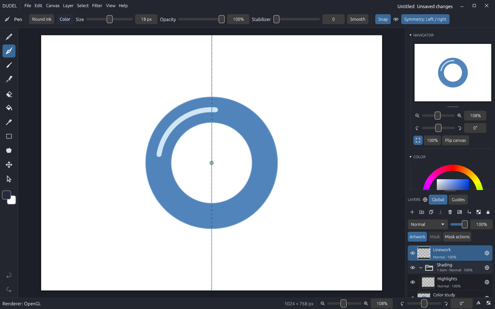
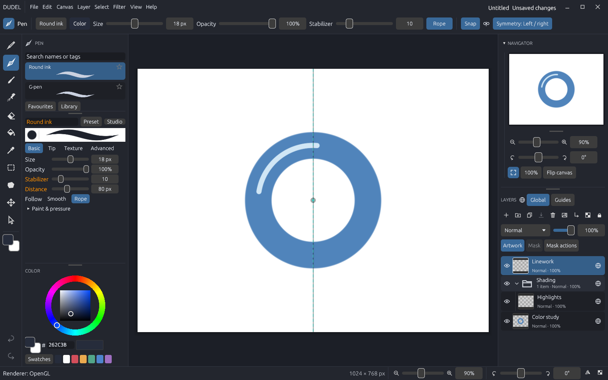
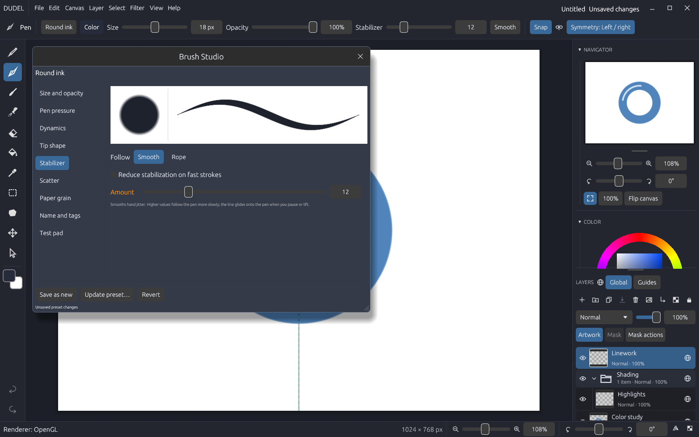
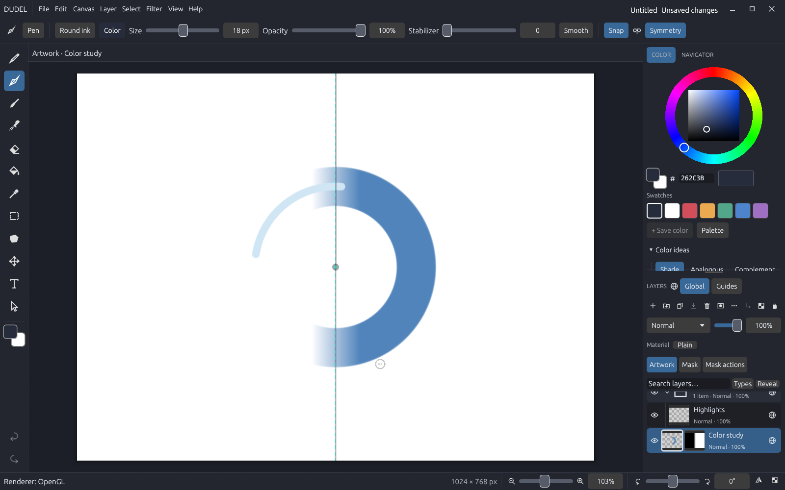
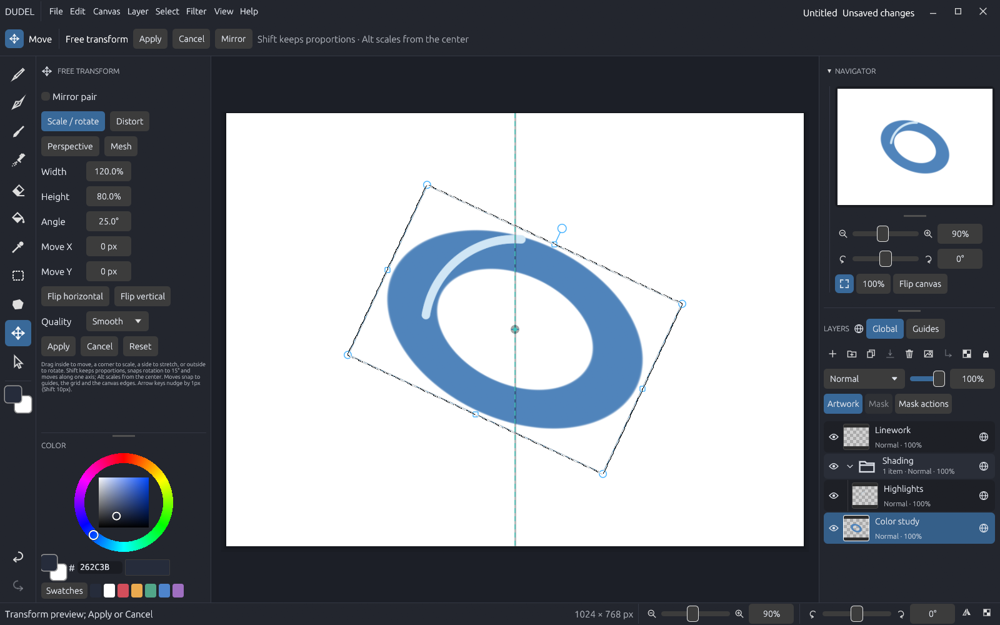
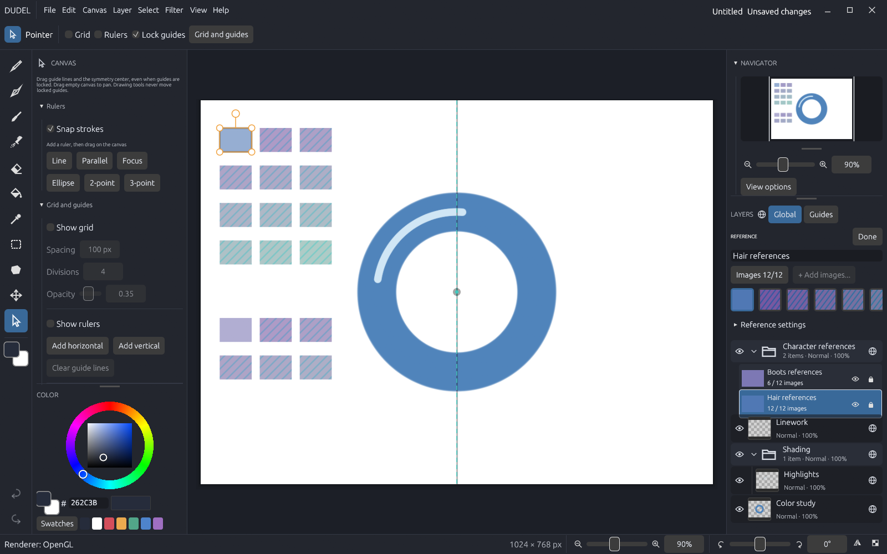
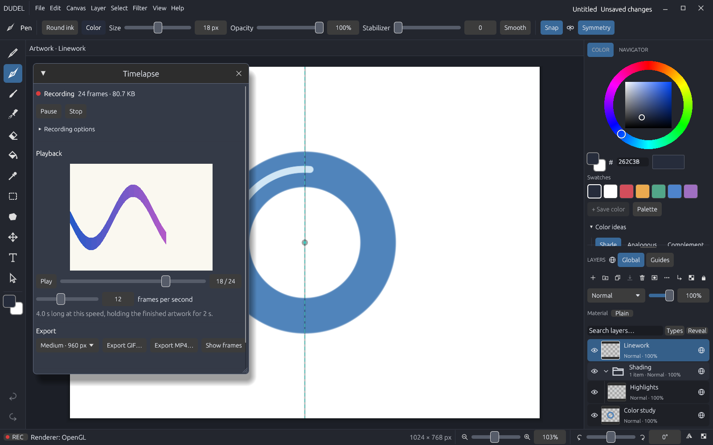

# Dudel

**A pen-first drawing app for Windows, written in Rust.** Pressure-sensitive
brushes with stabilization, layers and masks, selections and transforms, and
native project saving with crash recovery, built for illustrating on a pen
display or tablet.




**Contents:** [Features](#features) · [Download](#download-and-install) ·
[First steps](#first-steps) · [Pen tablets](#pen-tablets-and-latency) ·
[Documentation](#documentation) · [Limits](#current-limits) ·
[Build from source](#build-from-source) · [Contributing](#reporting-problems-and-contributing) ·
[License](#license)

## Features

**Drawing**
- Pencil, Pen, Brush and Airbrush tools, each with its own presets, size and settings.
- Pen pressure for size and opacity, editable pressure curves and brush dynamics.
- Stabilizer with two follow modes: **Smooth** eases toward the pen, **Rope**
  trails it on a string for steady curves and straight runs.
- Custom image tips, paper grain, scatter and tapers; an editable brush library
  and **Brush Studio** with a test pad.
- Fill with gap-friendly *Fill to edges*, Lasso fill/erase, color picker, symmetry
  (mirror and radial), rulers and guides with stroke snapping.

**Layers and editing**
- Raster layers, **vector layers**, folders, clipping, blend modes and nondestructive **layer masks**.
- Vector lines stay editable: pick them, then move, reshape, scale, rotate, smooth
  or recolor them. Fill can run under line art to the line centres.
- Editable **layer effects** (shadows, glows, strokes, overlays, bevel) and
  **adjustment layers** (levels, curves, hue/saturation and more, from PSD).
- Selections (rectangle, lasso, polygon, magic wand) and free transform with
  scale/rotate, distort, perspective and mesh, plus *mirror pair* edits for
  symmetric features such as eyes.
- Adjustments and filters, including Rhai and WebAssembly extensions; API 2
  plugins contribute brush presets, tool presets, commands and panels.
- **Command search** (`Ctrl+K`) and custom keyboard shortcuts.

**Your work stays safe**
- Editable `.dudel` projects with atomic saves, cancelable background saves and
  recovery copies; undo/redo throughout.
- Tabs for several projects, a separate preview window, reference images and
  boards that never become part of the artwork.
- Per-canvas **timelapse** recording that plays back in the app and exports as GIF or MP4 (FFmpeg required)
  or PNG frames; portable UI themes.
- PNG import/export, JPEG, lossless WebP, BMP and GIF image export, layered PSD export and SVG export of vector lines; [CSP and PSD import](FORMAT_SUPPORT.md) with editable layers
  (PSD shapes, gradient fills, layer effects and adjustment layers included) and
  clearly identified flattened fallbacks.

| | |
|---|---|
|  |  |
| **Brush settings**: size, opacity, stabilizer and Rope distance in the tool panel | **Brush Studio**: every brush setting with a live preview and test pad |
|  |  |
| **Layer masks**: paint, fill, lasso and transform masks without touching pixels | **Free transform**: numeric fields, flips, quality and mirror-pair editing |
|  |  |
| **References**: organize study images into boards; they never print or export | **Timelapse**: record a canvas and export a GIF or its PNG frames |

## Download and install

Dudel is **portable**: there is no installer.

1. Download `dudel-<version>-windows-x64.zip` from the
   [Releases page](https://github.com/swimmingyoshi/dudel/releases).
   Optionally compare its SHA-256 with the `.sha256` file published beside it.
2. Extract the **whole** ZIP anywhere (even a USB stick). Running `dudel.exe`
   from inside the ZIP only runs a temporary copy.
3. Run `dudel.exe`. Builds are not code-signed yet, so Windows SmartScreen may say
   "Windows protected your PC": choose **More info > Run anyway**.

The Visual C++ runtime is built in; nothing else needs installing. Keep
`dudel_thumbnails.dll` beside `dudel.exe` for optional `.dudel` thumbnails in File
Explorer. Artwork goes to `Documents\Dudel`; settings and recovery snapshots stay
in `%LOCALAPPDATA%\Dudel`. To uninstall, delete the folder; your projects stay.

Each release also publishes a matching **source ZIP** with vendored dependencies
and build instructions.

**Linux (experimental):** download `dudel-<version>-linux-x64.tar.gz`, extract it
and run `./dudel`. Pen pressure needs a Wayland session.

**Tested on** Windows 11 x64 (desktop RTX 3060 and an Intel UHD laptop) with an
XP-Pen Artist 12. Minimum Windows, RAM and GPU requirements have not been
established yet; see [tested systems](RELEASE_NOTES.md#tested-systems-and-prerequisites).

## First steps

**File > New canvas** opens presets (Sketch, Square, 4K and more), pixel dimensions
and DPI (300 by default). **Canvas > Canvas size** changes DPI on an existing
project and shows its print size. Changing DPI leaves pixel dimensions and artwork
unchanged. Resolution is saved in projects and PNG exports; older projects without
resolution metadata use 72 DPI.

Then:

| Action | Shortcut |
|---|---|
| Paint tools (tap again to cycle Pencil / Pen / Brush / Airbrush) | **B** |
| Eraser (hold and release to return to the previous tool) | **E** |
| Brush size smaller / larger | **[** / **]** |
| Swap foreground and background colors | **X** |
| Undo / Redo | **Ctrl+Z** / **Ctrl+Shift+Z** |
| Pan / zoom | Hold **Space** and drag / scroll |
| Fit canvas / actual pixels / flip view | **Ctrl+0** / **Ctrl+1** / **H** |
| Fill, Lasso, Selection, Move, Picker | **G**, **L**, **M**, **V**, **I** |
| New layer / duplicate layer | **Ctrl+Shift+N** / **Ctrl+J** |
| Free transform / deselect / invert selection | **Ctrl+T** / **Ctrl+D** / **Ctrl+Shift+I** |
| Pointer (move references, guides and rulers) | **O** |
| Save / Save as / Open | **Ctrl+S** / **Ctrl+Shift+S** / **Ctrl+O** |
| Next / previous tab, close tab | **Ctrl+Tab** / **Ctrl+Shift+Tab**, **Ctrl+W** |
| Hide or show the side panels | **Tab** |

**Help > Keyboard shortcuts** lists every binding. The [quick start](QUICK_START.md)
walks through drawing, layers, selections, saving, recovery and export.

## Pen tablets and latency

Enable **Windows Ink** in your tablet driver and pick a pressure-sensitive brush.
**View > Tablet input** shows the pressure and pen data Dudel receives.

**Low latency drawing is on by default.** Dudel shows each frame without waiting
for the display refresh, so ink keeps up with the pen; waiting for vsync with two
queued frames adds roughly 35-50 ms on a 60 Hz screen. If your display shows
brief tearing, untick **Low latency** in **View > Settings > Display > Graphics API and latency...** and
restart; Dudel keeps your choice. The same window chooses OpenGL (default),
DirectX 12 or Vulkan. With the stabilizer at 0 the stroke itself follows the pen
exactly; details are in the [quick start](QUICK_START.md#if-the-line-lags-behind-the-pen).

## Documentation

| I want to... | Read |
|---|---|
| Learn the app step by step | [Quick start](QUICK_START.md) |
| See what this release contains and its boundaries | [Release notes](RELEASE_NOTES.md) |
| Check which files Dudel opens and saves | [File format support](FORMAT_SUPPORT.md) · [Project format v4](PROJECT_FORMAT_V4.md) |
| Use timelapse, themes, references and brush presets | [Creator features](CREATOR_FEATURES.md) |
| Write or install extensions | [Plugin development](PLUGIN_DEVELOPMENT.md) · [Rhai SDK](plugins/SDK.md) · [WASM SDK](plugins/WASM_SDK.md) |
| Check tablet validation | [XP-Pen Artist 12 record](XP_PEN_VALIDATION.md) |
| Build, package and verify releases | [Distribution](DISTRIBUTION.md) · [Testing](TESTING.md) · [Release checklist](RELEASE_CHECKLIST.md) |
| Follow the project's status and plans | [Release status](RELEASE_STATUS.md) · [0.2.0 plan](UPGRADE_PLAN.md) · [Workflow priorities](UX_WORKFLOW_PLAN.md) · [Historical 0.1 delivery plan](DELIVERY_PLAN.md) |
| Track the Linux port | [Linux port](LINUX_PORT.md) |
| Read engineering notes and measurements | [`research/`](research/) · [`benchmarks/`](benchmarks/) |

## Current limits

- Canvases are up to 16,384 pixels per side and 100 megapixels in total (for
  example 10,000 x 10,000, Clip Studio Paint's limit, or a 800 x 16,384 strip).
  Documents hold up to 1,000 raster layers, 2,000 layer/folder entries and
  folder depth ten, with 2 GiB of stored pixels including masks (only painted
  tiles count).
  Projects using more than 32 layers or the newer blend modes need this
  version or later.
- Native saves use project format v4, v5 when layer masks are used, or v6 when
  layer effects, adjustment layers or fill opacity are used, or v7 for vector
  layers; newer files need a compatible
  Dudel (older builds refuse them rather than drop that data). Indexed `.didx` storage is experimental.
- CSP/PSD import is bounded to the documented subsets. Unsupported CSP
  files can open their saved preview, often at lower resolution. Unsupported PSD
  layer features use the saved composite when available. Color-managed print
  workflows and universal format compatibility are not supported.
- Windows x64 is the supported platform; Linux builds are experimental.

See [release notes](RELEASE_NOTES.md#current-boundaries) for the full list.

## Build from source

Install [Rust](https://rustup.rs) and the Visual Studio C++ build tools with the
Windows SDK. The verified compiler is Rust 1.97.1 (pinned in `rust-toolchain.toml`).

```powershell
cargo build --locked --release --bin dudel
.\target\release\dudel.exe
```

Development checks (Python 3.11+ is required for the script's extra checks):

```powershell
.\scripts\Verify.ps1              # formatting, tests, clippy, Python checks
.\scripts\Verify.ps1 -Mode Full   # everything CI runs, including release builds
```

The script also enables a pre-push hook that refuses unformatted Rust and
personal paths in tracked files. `.\scripts\Package.ps1` builds the binary and
matching-source ZIPs with checksums and third-party notices; see
[distribution](DISTRIBUTION.md). Linux instructions are in [testing](TESTING.md)
and [the Linux port](LINUX_PORT.md).

## Reporting problems and contributing

Trying Dudel for the first time? The [30-minute test](TESTER_GUIDE.md) says what to
try and how to send feedback.

Open an issue with the bug-report template. Include the version and build hash
from `BUILD.json`, your Windows version, GPU and tablet drivers, display scaling,
canvas and layer sizes, brush settings and the steps to reproduce on a disposable
canvas. Run `.\scripts\Verify.ps1` before opening a pull request.

## License

Dudel is **GPL-3.0-only**; see [LICENSE](LICENSE). Official builds may be sold,
and the matching source is always available so you can build it yourself.
Third-party components keep their own licenses; packaged builds include their
notices and identify the corresponding source archive.
