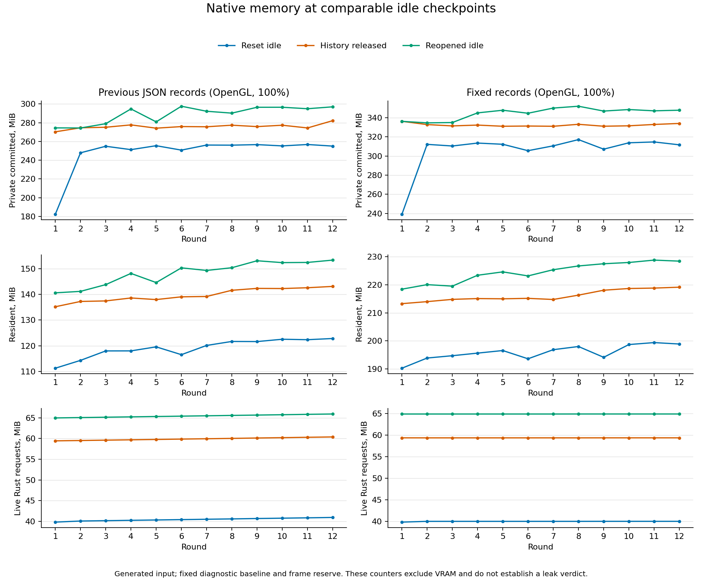

# Fixed native diagnostic checkpoint storage

2026-10-16. Follow-up to `RUST_ALLOCATION_PROFILE.md` and its 0.693 MiB
matching-idle live Rust drift over rounds 4 through 12.

## Change and comparison

The native diagnostic previously retained one nested `serde_json::Value` per
checkpoint. Each sample allocated map nodes and string keys, and the containing
Vec grew during the workload. This was diagnostic ownership mixed into the
process-wide Rust allocation measurements.

Checkpoint records now contain numeric fields, optional fixed-size memory
snapshots and a static label. A Vec reserves every checkpoint before warmup:
23 in short mode or 288 in the existing twelve-round drawing mode. Sampling
stops with an error if that reserve is exhausted. Records serialize to the same
JSON field names at report completion, after all memory samples have been taken.
The normal drawing app is unaffected; this is a measurement correction, not
a production performance improvement.

Every checkpoint reports `diagnostic_checkpoint_capacity_bytes` and
`diagnostic_checkpoint_used_bytes`. Used bytes count preceding records at the
sampling boundary, excluding the current record. Increasing used bytes do not
represent increasing requested heap capacity. The analyzer checks constant
capacity, consistent record size, exact usage progression and sufficient slots;
it continues to accept historical reports without these new fields.

Compare the preserved JSON-backed profiled executable and its twelve-round run
with the fixed-record profiled build under the same generated 2048x2048,
four-layer OpenGL workload, 100% application zoom. Keep app commands, byte
oracles, original-document ownership, preallocated frame reserve, history checks,
save/reopen and pacing unchanged. This is a sequential diagnostic comparison,
not a controlled timing or renderer benchmark. Windows process counters can
fluctuate independently of live requested Rust bytes.

Frozen new profiled executable:
`target/qa/dudel-fixed-checkpoints-profile.exe`, SHA-256
`AF1C238713F0A5B4673A1597EBF29730DBE829BF617F5AF113AFFFBB8ACBCD4A`.
Historical comparison executable and reports remain intact; see
`RUST_ALLOCATION_PROFILE.md` for their identities.

## Evidence

The analyzer accepted the historical twelve-round report and a generated valid
fixed-record fixture. It rejected fixtures with capacity growth or a missing
storage counter. Targeted native snapshot-oracle regression, all-target/all-feature
warnings-denied Clippy and the optimized profiled build passed.

The new twelve-round OpenGL run exited zero: 408.220 seconds, 29,261 callbacks,
12 generated strokes, 192 byte-oracle mask edits and 12 save/reopens. All 288
checkpoints were present; checkpoint reserve stayed **57,600 bytes** (200-byte
records). History returned to zero at every released/initial/final idle, and
registered snapshot/display counts were constant at matching tail checkpoints.

| Matching idle stage | Previous Rust live drift, rounds 4-12, MiB | Fixed-record Rust drift, KiB | Fixed-record private drift, MiB |
| --- | ---: | ---: | ---: |
| Reset fixture | +0.693 | +6.250 | -1.836 |
| History released, before save | +0.693 | +6.250 | +1.711 |
| Reopened, history released | +0.693 | +6.250 | +2.801 |

Replacing the growing JSON metadata reduced matching-idle Rust drift from
727,112 to 6,400 bytes. This strongly links the bulk of the earlier small drift
to diagnostic ownership; it does not independently assign the remaining 6.25
KiB. Final reopened idle held 64.933 MiB of live Rust requests, 347.910 MiB
process-private commitment and 228.453 MiB resident. Lifetime Rust peak was
135.991 MiB. The first cancellation still added 69.875 MiB private commitment
with only 18.914 KiB more live Rust requests. The much larger process-memory
discrepancy remains outside the requested-byte accounting.

Raw report and inspected screenshot:
`benchmarks/fixed-checkpoint-profile-sustained-100.{json,png}`; launch logs:
`target/qa/fixed-checkpoint-profile-sustained-100.{stdout,stderr}.log`.
Validated comparison: `benchmarks/fixed-checkpoint-comparison.json`.
Figure generated with:

```text
python research/plot_native_memory.py benchmarks/fixed-checkpoint-comparison.json benchmarks/fixed-checkpoint-memory --labels "Previous JSON records (OpenGL, 100%)" "Fixed records (OpenGL, 100%)"
```



PNG was inspected; an SVG is also available. Process panels use independent
vertical ranges. Absolute process counters differ between sequential launches;
do not infer a production-memory reduction from the two columns. The figure's
Rust panel shows the metadata effect, separately from process commitment.

GPU inventory recorded in `target/qa/fixed-checkpoint-gpu-context.json` reports
NVIDIA GeForce RTX 3060, driver version 32.0.15.9579. Inventory alone does not
identify the OpenGL allocator owner.

## Matched short renderer checks

The same frozen profiled executable ran the sixteen-edit short workload at
1280x800, 100%, with `DUDEL_RENDERER=opengl` and `DUDEL_RENDERER=dx12` in separate
child-process environments. Both exited zero with all 23 checkpoints, the byte
oracles, Cancel, Undo/Redo and save/reopen verified. The DX12 report identifies
`Dx12 on NVIDIA GeForce RTX 3060`, confirming that it did not use the OpenGL
fallback. Each checkpoint reserve stayed 4,600 bytes.

| Measurement | OpenGL | DirectX 12 |
| --- | ---: | ---: |
| Elapsed seconds | 31.536 | 31.160 |
| Initial private commitment, MiB | 175.672 | 476.035 |
| Cancelled-idle private commitment, MiB | 244.188 | 476.477 |
| First-preview private increase, MiB | 68.516 | 0.441 |
| First-preview live Rust request increase, KiB | 18.914 | 189.914 |

The discrepancy is strongly backend-dependent in these two runs. It does not
identify an allocation stack or prove a leak, and the higher DX12 initial
commitment prevents interpreting its smaller delta as a lower overall memory
cost. Renderer defaults/preferences were not changed. This is one short check
per backend, not a sustained DX12, timing, GPU-memory or physical-input result.
CPU pixel oracles verify document state; screenshots provide visual renderer
evidence, not pixel-exact GPU readback equivalence.

Reports/captures:
`benchmarks/fixed-checkpoint-profile-{gl,dx12}-short-100.{json,png}`.
Logs: `target/qa/fixed-checkpoint-profile-{gl,dx12}-short-100.{stdout,stderr}.log`.
Checked comparison: `benchmarks/fixed-checkpoint-renderer-comparison.json`;
DX12-only summary: `benchmarks/fixed-checkpoint-dx12-summary.json`.
Both renderer screenshots were inspected: saved state, transformed coverage,
selected mask, layer list and navigator agree with the scripted final state.

## Build checks

Full suites: **762 passed** with profiling, **759 passed** without it; zero failed,
one existing high-memory test ignored in each. Default and all-feature all-target
warnings-denied Clippy, formatting, Git whitespace and optimized builds passed.
Logs: `target/qa/fixed-checkpoint-profile-tests.log`,
`target/qa/fixed-checkpoint-normal-tests.log`, `target/qa/fixed-checkpoint-clippy.log`,
`target/qa/fixed-checkpoint-normal-clippy.log`, and
`target/qa/fixed-checkpoint-{profile,normal}-release.log`.

Restored normal release and frozen `target/qa/dudel-fixed-checkpoints-normal.exe`
SHA-256: `F3F90C501484C88C6E7C4FB2699EE4D714E1269110FF94BF9F616C21D391E988`.
The restored default short native run also exited zero, completed all sixteen
edits and save/reopen, and explicitly reported allocation profiling disabled
with null allocation samples. All 23 checkpoints fit the constant 3,312-byte
reserve (144-byte records). Report and inspected screenshot:
`benchmarks/fixed-checkpoint-normal-short-100.{json,png}`; checked summary:
`benchmarks/fixed-checkpoint-normal-summary.json`; logs:
`target/qa/fixed-checkpoint-normal-short-100.{stdout,stderr}.log`.
Final whitespace result: `target/qa/fixed-checkpoint-whitespace.log`.

The full application goal and external/hardware release gates remain open;
allocator counters alone do not identify heap backing, C/driver allocations
or GPU ownership. Physical pen latency and longer modern-renderer sessions
require separate evidence.
