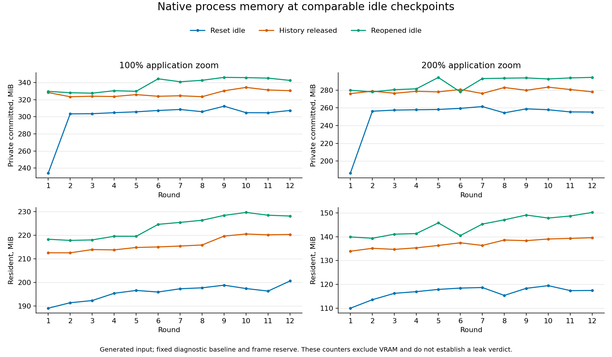

# Repeated native drawing and resource study

2026-10-16. Extends the short checks in `NATIVE_MASK_SESSION.md` and
`MASK_SAMPLER_OPTIMIZATION.md`. This is generated native-window integration
evidence; physical input and release acceptance remain separate.

## Workload

```text
dudel.exe --soak-native-drawing-session NEW_REPORT.json 1280 800 SCALE
```

Long mode keeps one native app/renderer alive for twelve rounds using a supported
2048x2048 four-layer fixture: a dense masked raster and three sparse artwork
layers.
The first raster uses the benchmark's uniform semi-transparent artwork and keeps
its alpha lock enabled. The dense mask varies spatially; this is a specific
masked-painting workload, not an exhaustive brush/document stress matrix.

Each round performs:

1. Two seconds of settled warmup on the same retained fixture.
2. Start/Cancel of a full-quality fractional mask transform, preserving the clean
   source, empty history and saved state.
3. One second of generated brush input, scheduled at 240 samples/second through
   the actual canvas packet path. Pressure varies; the brush uses stabilization.
   The target artwork must change while other artwork stays shared and all
   document metadata/masks remain unchanged. Undo and Redo must restore exact
   pixel values and metadata.
4. Sixteen fractional mask translations, each compared against the independent
   four-tap oracle. Each transform preserves artwork allocation identity and is
   undone and redone before the next edit.
5. Undo all seventeen actions to the round's baseline, then redo all seventeen
   to the final result, checking exact state and exhausted history stacks.
6. Release history, idle for two seconds, save through the normal asynchronous
   app path and reopen through the real loader. Reopening must produce a fresh
   mask identity and matching artwork, coverage and mask flags.
7. Release diagnostic result ownership and idle for two more seconds. Unless
   this is the final round, reset through the normal replacement path to the
   retained baseline and repeat.

The existing `--soak-native-mask-session` remains a one-round, sixteen-transform
check without the generated stroke. Reports are version 2 and now identify the
round/cycle of each callback and checkpoint. Output and companion screenshot
paths must be new. Sessions use generated data, private preferences and temporary
project storage, without loading or modifying user artwork/settings.

## Measurement and verification boundaries

UI-prefix time ends before the diagnostic driver. It includes the normal canvas
handling of generated packets, normal render/texture preparation and other app
work before that boundary. `diagnostic_app_command_ms` separately measures the
instrumented preview start/apply/cancel, Undo/Redo, save and load app calls. Those
command times are included inside the total driver time; they must not be hidden
when assessing operation responsiveness. Remaining driver time includes byte
oracles, snapshots, memory sampling, bookkeeping and fixture reset work.

Callback intervals also include scheduling, renderer work and diagnostic
verification. None of these measurements is GPU execution duration, FPS or
pen-to-display latency. Generated packets bypass OS/tablet delivery, so neither
device discovery nor physical XP-Pen pressure/latency is verified here.

The settled criterion remains three consecutive callbacks with no dirty display,
pending render/texture job or stale thumbnails, plus a ready affine preview when
applicable. Idle checkpoints add two seconds after that criterion. This is not a
GPU fence. Process counters cover resident and private committed memory, not VRAM.

The native snapshot oracle compares logical pixel bytes, masks and metadata.
Region-patch Undo can restore identical bytes in fresh storage, so allocation
identity is not a correctness requirement for Undo/Redo. A dedicated regression
accepts equal restored storage and rejects changed pixels, masks and metadata.
Mask transforms still have a separate strict untouched-artwork sharing check.

Memory checkpoints include the fixed retained diagnostic baseline. A decoded
reopened document has distinct ownership, so compare matching checkpoint types
across rounds rather than comparing initial and post-reopen values directly.
Frame samples reserve a fixed capacity in advance; used/capacity bytes are
recorded separately. Tracked live bytes exclude some allocator/driver/UI ownership
and must not be equated to process commitment.

Analysis helper:

```text
python research/analyze_native_session.py REPORT_100.json REPORT_200.json --output NEW_SUMMARY.json
```

The helper rejects incomplete round/checkpoint sequences, reports nearest-rank
p95 and preserves the underlying idle series. Tail drift omits the first three
rounds. It makes no automatic leak or release-readiness decision.

## Results

Both long reports passed independent completeness checking: twelve strokes and
192 mask edits per scale, per-edit and full-sequence Undo/Redo, twelve verified
save/reopens, and 288 checkpoints each. Together they cover 24 generated strokes,
384 mask edits and 24 save/reopens across 813.54 seconds. The tested renderer was
OpenGL, with 1280x800 and 640x400 logical viewports at 1 and 2 pixels per point.

| Zoom | Seconds | Callback samples | UI-prefix p95, ms | Active UI-prefix p95, ms | Brush-input/lift UI-prefix p95, ms | UI-prefix maximum, ms |
| --- | ---: | ---: | ---: | ---: | ---: | ---: |
| 100% | 404.62 | 28,964 | 2.857 | 2.948 | 2.221 | 8.328 |
| 200% | 408.92 | 29,323 | 2.695 | 2.781 | 1.952 | 8.269 |

Active per-round UI-prefix p95 ranged from 2.824 to 3.125 ms at 100% and 2.733
to 2.816 ms at 200%. These describe this generated workload; they are not an
end-to-end latency, GPU or presentation-rate measurement. Additional layout
callbacks must not be counted as displayed frames.

Instrumented command timing identifies the action executed during each phase:

| App call | 100% p95 / maximum, ms | 200% p95 / maximum, ms |
| --- | ---: | ---: |
| Apply/Cancel preview (Preview phase, mixed calls) | 0.317 / 1.281 | 0.274 / 1.748 |
| Undo after mask commit (Applied) | 2.854 / 3.537 | 2.880 / 3.732 |
| Redo after mask Undo (Undone) | 1.707 / 2.039 | 1.949 / 2.421 |
| One full-sequence Undo step | 5.449 / 7.432 | 5.262 / 7.049 |
| One full-sequence Redo step | 2.219 / 2.733 | 2.321 / 3.150 |

Maximum diagnostic driver time was 156.74/150.53 ms. It includes expensive
verification and is a reason not to turn callback intervals into user-facing FPS
or pen latency. Separate mask-worker latency remains outside these synchronous
command-call timings.

## Resource findings

History peaked at 76.45 MiB and returned to zero at every released-history idle
checkpoint. At matching checkpoints in rounds 4-12, registered document/snapshot
allocations and display buffers were exactly stable. Across all twelve rounds,
registered snapshot totals varied by at most 15 bytes; display buffer counts
were constant.
Registered live-plus-additional snapshots were 25.535 MiB at reset idle,
44.844 MiB after history release before save, and 50.349 MiB after reopen. The
fixed original diagnostic document accounts for the extra retained snapshot
ownership after edits/reopening. Display RGBA buffers remained 25 MiB. The frame
reserve was 10.071 MiB; used trace storage reached 2.431/2.461 MiB.

Process counters tell a different, incomplete ownership story:

| Matching idle checkpoint | 100% private drift, rounds 4 to 12, MiB | 200% private drift, rounds 4 to 12, MiB |
| --- | ---: | ---: |
| Reset fixture, before another round | +2.590 | -2.582 |
| History released, before save | +6.824 | -0.602 |
| Reopened document, history released | +12.051 | +12.914 |

Over the same tail, used trace storage grew by about 1.62/1.64 MiB, and registered
snapshot/display ownership stayed constant. The first cancelled preview increased
private commitment by 67.70/69.40 MiB without matching retained document/display
growth. Reopened-idle private commitment ended at 342.55/294.45 MiB, with resident
memory at 228.15/150.22 MiB. The curves fluctuate and sometimes fall after reset;
these observations neither prove a leak nor establish a closed memory gate.
Allocator backing, UI/renderer/driver ownership and transient allocation behavior
still need profiling. The fixture and traces do not represent hours of physical
drawing, multiple documents, every renderer or all supported layer/brush cases.



The chart uses separate ranges per zoom; do not interpret the absolute difference
as a controlled scaling-performance comparison. Raw snapshot counters, display
counters and process counters remain separate in the summary.

## Artifacts and checks

- **759 passed, zero failed, one existing high-memory test ignored**. All-target
  warnings-denied Clippy, formatting, Git whitespace and optimized offline build
  pass. Logs: `target/qa/sustained-native-{tests,clippy,diff-check,release}.log`.
- Current release and identical frozen `target/qa/dudel-sustained-native-v2.exe`
  SHA-256: `96C645773B3D705732A94E0F5C72D9AD3BAD7C125E2D10D69FDB86DD161369F3`.
- Native reports: `benchmarks/sustained-native-release-{100,200}.json`; companion
  PNGs were inspected at both scales. The selected mask, saved feedback, transformed
  coverage, drawing result and compact controls agree with the scripted state.
- Logs: `target/qa/sustained-native-v2-{100,200}.{stdout,stderr}.log`.
  The 100% launcher signalled a completion-check failure after the complete report
  and PNG had been written; both were independently validated. The 200% launch
  used `Start-Process -Wait` and confirmed exit code zero. No completed long run
  was restarted because of that launcher observation.
- Legacy short-mode compatibility passed with exit code zero, sixteen mask edits,
  save/reopen, report and screenshot: `benchmarks/sustained-native-short-compat.*`.
- `benchmarks/sustained-native-summary.json` retains the checked series and
  distributions. `research/analyze_native_session.py` also parsed a historical
  report and rejected a fixture with a missing edit check.
- Plot: `benchmarks/sustained-native-memory.{png,svg}`, generated by
  `research/plot_native_memory.py`; the PNG was visually inspected.

Follow-up optional Rust allocation profiling reproduced the preview discrepancy
and measured matching-idle live-request drift separately from process commitment:
see `RUST_ALLOCATION_PROFILE.md`. Heap backing/external ownership and diagnostic
metadata attribution remain open. Physical XP-Pen behavior, real OS input/clipboard exchange, GPU interaction,
supported CSP fixtures and packaging remain open. The professional application
goal remains active.
