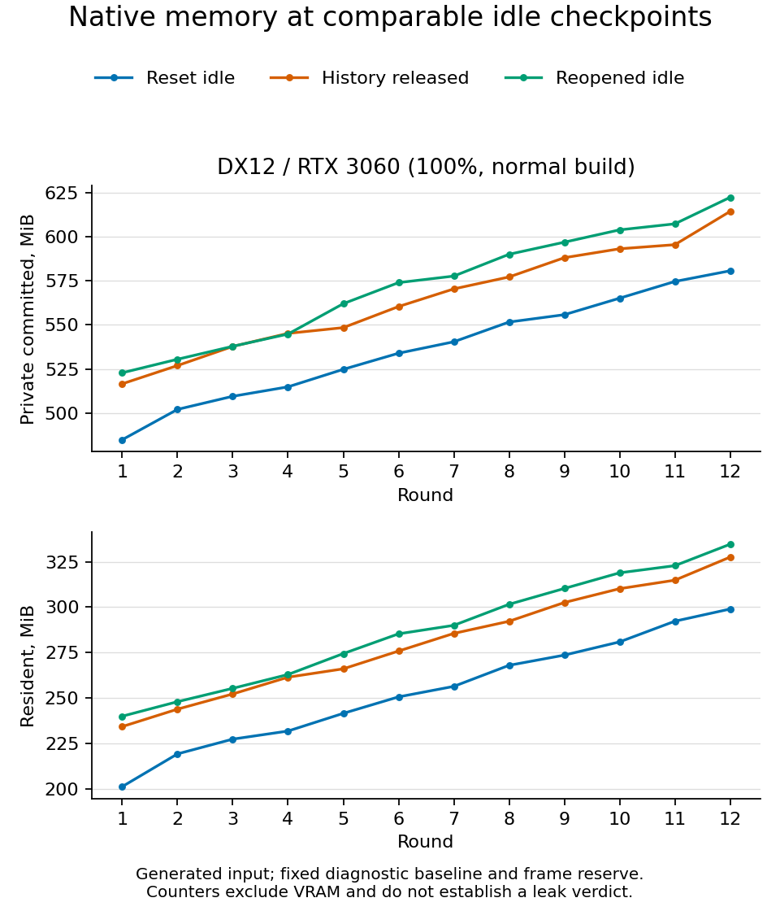

# Sustained native DirectX 12 drawing check

2026-10-17. Extends the short backend checks in `FIXED_NATIVE_CHECKPOINTS.md`.
This is generated native-window integration evidence, not physical input or
release certification.

## Artifact and workload

Frozen normal executable: `target/qa/dudel-fixed-checkpoints-normal.exe`, SHA-256
`F3F90C501484C88C6E7C4FB2699EE4D714E1269110FF94BF9F616C21D391E988`.
The build has allocation profiling disabled. It predates the automatic-panel-layout
menu addition; drawing/diagnostic behavior is the frozen baseline for this study.

Set `DUDEL_RENDERER=dx12` in the launching child-process environment and run:

```text
dudel-fixed-checkpoints-normal.exe --soak-native-drawing-session NEW_REPORT.json 1280 800 1
```

The report identifies **Dx12 on NVIDIA GeForce RTX 3060**, so no OpenGL fallback
was used. This is the same twelve-round generated brush/mask/history/save/reopen
workload described in `SUSTAINED_NATIVE_DRAWING.md`, with fixed diagnostic
checkpoint storage. User artwork, preferences and renderer settings are isolated.

## Correctness and responsiveness evidence

The process exited zero after 404.490 seconds and 29,170 callbacks. It completed
12 generated pressure-varying brush strokes, 192 byte-oracle mask transforms and
12 asynchronous save/reopens, with per-edit/full Undo/Redo and Cancel verification.
All 288 checkpoints fit a constant 41,472-byte reserve of 144-byte records.
History peaked at 76.448 MiB and returned to zero at every released/initial/final
idle. Matching tail document/display ownership remained constant.

UI-prefix median/p95/maximum were 1.908/2.890/8.698 ms. Active-prefix p95 was
2.990 ms; generated-brush prefix p95 was 2.169 ms. Maximum instrumented app
command was 7.598 ms (the full Undo sequence). These are CPU app/diagnostic
boundaries, not GPU time, FPS, end-to-end pen latency or a controlled backend
speed comparison. Callback intervals include oracle and diagnostic work; maximum
diagnostic driver time was 165.119 ms.

## Open resource finding

Stable registered document/display counters did **not** imply stable process
memory. From matching rounds 4 to 12:

| Idle stage | Private commitment drift, MiB | Resident drift, MiB |
| --- | ---: | ---: |
| Reset fixture | +65.953 | +67.133 |
| History released, before save | +69.301 | +66.066 |
| Reopened, history released | +77.680 | +71.676 |

Reopened-idle commitment increased from 522.793 MiB in round 1 to 622.492 MiB
in round 12. This grows despite zero history and constant registered snapshots,
display buffers and trace/checkpoint capacity. This normal build has no global
Rust allocation counters, so it cannot distinguish Rust-side renderer caches,
heap backing or external GPU/driver allocation behavior. The short DX12 run's
small first-preview delta did not establish repeated-use resource stability.
The DX12 memory gate stays open; no leak owner or bounded-growth conclusion is
established by these counters.



Follow-up `DX12_ALLOCATION_OWNERSHIP.md` repeats this workload with Rust and GPU
suballocator reports. It reproduces about 30 MiB of matching-idle retained Rust
growth while GPU suballocator totals stay constant. Next identify the retained
Rust call stacks/owners; the memory gate remains open.
Physical XP-Pen, GPU ownership/latency, OS clipboard, CSP fixtures and packaging
remain independent release gates.

## Evidence files

Raw report and inspected native screenshot:
`benchmarks/sustained-native-dx12-normal-100.{json,png}`. Checked summary:
`benchmarks/sustained-native-dx12-normal-summary.json`. Memory figure:
`benchmarks/sustained-native-dx12-memory-v2.{png,svg}`.
Launch logs: `target/qa/sustained-native-dx12-normal-100.{stdout,stderr}.log`.
The existing native analyzer verifies complete cycles/checkpoints and fixed
record storage; it does not label the growing process counters as a pass.
